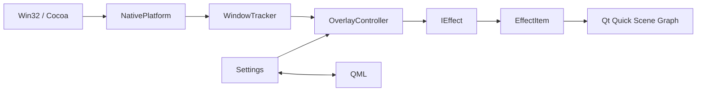

# Архитектура и границы реализации

## Поток данных

`NativePlatform` возвращает только идентификатор, границы, видимость и активность окна; отвечает за нативное позиционирование, курсор и пользовательский автозапуск. `WindowTracker` переводит системные события на GUI-поток и проверяет геометрию каждые 33 мс, пока активен эффект. В ожидании / после полного таяния — раз в 750 мс.

`OverlayController` управляет видимостью и QChronoTimer. Обновление симуляции и настроек выполняется в GUI-потоке. `EffectItem::updatePaintNode` читает кадр только во время синхронизации Scene Graph, когда GUI-поток заблокирован Qt. Геометрия принадлежит render thread; QSGNode не изменяется из обработчиков GUI. Окно уничтожается до движка.

## Снег и бюджет

- Координаты движка — логические точки. Размеры частиц 0.75–3.5 pt, скорости зависят от глубины и режима.
- Ветер и две низкочастотные синусоиды формируют дрейф; влияние курсора затухает экспоненциально.
- Время кадра ограничено 100 мс, затем делится на шаги не больше 1/120 секунды. Возврат из сна не создаёт лавины частиц.
- Плотность нормируется на площадь; 1400 — общий предел, часть бюджета оставлена для разлетающегося снега.
- Поле высот: шаг около 8 pt, максимум 1025 узлов. Осевшие частицы пополняют локальное гауссово пятно, ограниченная диффузия сглаживает поверхность. Сугробы всегда ниже заданного максимума и 25% высоты окна. Неравномерный локальный предел сохраняет волнистый силуэт даже после долгого снегопада; его коэффициенты вычисляются при resize, а не каждый кадр.
- Два QSGGeometryNode: сугробы и снежинки; геометрия батчится, нет QML-объекта на каждую частицу. Края полупрозрачные, цвет premultiplied alpha. Одна снежинка — 72 вершины.
- Рендер использует стандартный аппаратный backend Qt (обычно Metal / D3D11); software backend не считается поддержанным, поскольку QSGVertexColorMaterial ориентирован на стандартный Scene Graph. Ошибка инициализации графики скрывает overlay и показывается в настройках.
- Каждые две секунды контроллер оценивает задержанные тики / незавершённые кадры. Плотность постепенно снижается до 30%, затем восстанавливается. Это эвристика, не измерение GPU-загрузки.
- Скрытый Telegram останавливает таймер эффекта. Выключение снегопада оставляет только затухание / таяние; после них нет постоянных update().

## Нативные координаты

Windows возвращает физические пиксели DWM. `SetWindowPos` получает их напрямую; Qt обрабатывает `WM_DPICHANGED`. Глобальные координаты не делятся на DPR, поскольку смешанные масштабы мониторов имеют разные начала координат. Курсор преобразуется `ScreenToClient`, затем переводится в логические точки через DPR overlay.

macOS: Quartz / Qt используют глобальные координаты с верхним левым началом, Cocoa — с нижним левым. При преобразовании используется высота **главного** NSScreen, а не высота текущего монитора. Размер NSWindow выражается в points, Retina backing scale ведёт Qt. Фрейм не включает тень.

macOS использует `CanJoinAllSpaces | FullScreenAuxiliary | IgnoresCycle`; overlay привязан к окну Telegram из onscreen-списка и располагается над ним даже при смене фокуса. Проверка Spaces, Mission Control, Stage Manager и нескольких дисплеев обязательна: универсальное корректное поведение не подтверждено одними флагами.

## Расширение

Снег и дождь выбираются через EffectKind и createEffect. При смене режима OverlayController подключает новый движок к EffectItem и сбрасывает планирование кадров. RainEffect формирует капли, брызги, травинки и приглушённые вспышки; настройки снега и дождя хранятся раздельно. Новый эффект реализует `IEffect` (`configure`, `resize`, `advance`, `frame`, `needsAnimation`). `EffectFrame` — текущий контракт частиц и нижней поверхности; эффекты с другими примитивами могут расширить его или получить отдельный renderer. `ICollisionSurface` отделяет семантику оседания от поиска геометрии. Для масок сообщений понадобится отдельный надёжный поставщик координат; такого поставщика в MVP нет.

## Известные ограничения

- Одно окно за раз; выбор на macOS — первое нормальное onscreen-окно процесса, на Windows — окно Telegram на переднем плане или последнее доступное окно Telegram.
- Polling геометрии на macOS может дать задержку около 33 мс при перемещении. AX-наблюдатель не подключён, чтобы не требовать Accessibility для базовой функции.
- При смене активного приложения overlay остаётся над Telegram в порядке наложения окон.
- Идентификация Windows проверяет `Telegram.exe`, macOS — известные bundle ID. Это обнаружение клиента, а не криптографическая проверка происхождения бинарника.
- Нет измерений CPU/GPU на реальных дисплеях и нет гарантии FPS на любом железе. См. протокол приёмки.

## Первичные источники

- [Qt: scene graph threading](https://doc.qt.io/qt-6/qtquick-visualcanvas-scenegraph.html)
- [Qt: vertex colors and premultiplied alpha](https://doc.qt.io/qt-6/qsgvertexcolormaterial.html)
- [Microsoft: layered windows and input transparency](https://learn.microsoft.com/en-us/windows/win32/winmsg/window-features#layered-windows)
- [Microsoft: SetWindowPos](https://learn.microsoft.com/en-us/windows/win32/api/winuser/nf-winuser-setwindowpos)
- [Apple: CGWindowListCopyWindowInfo](https://developer.apple.com/documentation/coregraphics/cgwindowlistcopywindowinfo(_:_:))

Визуальная идея атмосферного снега сопоставлялась с [Flake](https://tryflake.ru/); его код, графические ресурсы и композиция интерфейса не заимствованы.
